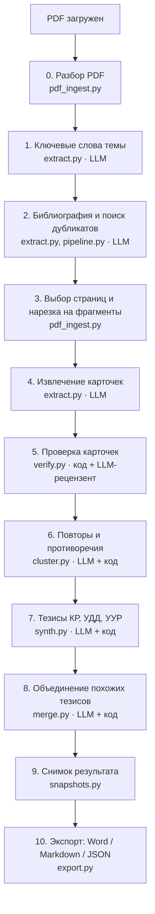

# KRGen: черновик клинической рекомендации из научных статей

KRGen — учебный прототип по ТЗ «Система подготовки клинических рекомендаций из научных статей».

На вход: PDF научных статей по одной медицинской теме.
На выходе: черновик клинической рекомендации (КР) по структуре приказа Минздрава № 103н
в Word, Markdown и JSON.

Каждое утверждение черновика прослеживается до дословной цитаты и страницы PDF:

```
PDF → страница + дословная цитата → карточка доказательства (проверенная) → тезис КР → Word / JSON
```

> Результат — черновик для экспертной проверки. Для лечения пациентов он не предназначен.

**Где работает:** https://test.savkin.xyz (вход по паролю). Как устроен сервер — в [deploy/README.md](deploy/README.md).

---

## Содержание

1. [Как работает прогон: этапы по порядку](#1-как-работает-прогон-этапы-по-порядку)
2. [Кто что решает: модель или код](#2-кто-что-решает-модель-или-код)
3. [Карта модулей](#3-карта-модулей)
4. [Где хранятся данные](#4-где-хранятся-данные)
5. [Правки эксперта и повторная обработка](#5-правки-эксперта-и-повторная-обработка)
6. [Установка и запуск](#6-установка-и-запуск)
7. [Настройки](#7-настройки)
8. [Документация](#8-документация)

---

## 1. Как работает прогон: этапы по порядку

Прогон запускается кнопкой «▶ Обработать» в интерфейсе или командой `python -m krgen.cli run <проект>`.

Порядок работы такой. Сначала из статей извлекаются отдельные утверждения с цитатами (карточки).
Затем каждую карточку проверяют: код сверяет её с текстом PDF, а модель-рецензент — по смыслу.
Только после этого проверенные карточки группируются, и из групп модель пишет тезисы КР.
Тезисы не извлекаются из статей напрямую: их пишут по уже проверенным карточкам.



Этапами 1–9 управляет `run_project()` в [krgen/pipeline.py](krgen/pipeline.py). Каждый этап сразу
сохраняет результат в базу. Если прогон оборвался, повторный запуск доделает недостающее. Ответы
модели кэшируются, поэтому повторная обработка тех же данных бесплатна.

### Этап 0. Разбор PDF при загрузке

**Файл:** [krgen/pdf_ingest.py](krgen/pdf_ingest.py), функция `add_document()`. Модель не используется.

- Считает SHA-256 файла и «отпечаток» текста. Одна и та же статья под другим именем помечается
  дубликатом (`duplicate`).
- Вытаскивает текст постранично (библиотека PyMuPDF) и размечает страницы: основной текст
  (`body`), список литературы (`references`), страница без текстового слоя, то есть скан (`no_text`).
- Копия PDF сохраняется в `data/uploads/<проект>/`.

### Этап 1. Ключевые слова темы

**Файл:** [krgen/extract.py](krgen/extract.py), функция `ensure_keywords()`. **LLM: 1 запрос на проект.**

Модель составляет русские и английские термины темы КР, например «distal radius», «перелом
предплечья». По ним на этапе 3 отбираются страницы длинных книг и руководств.

### Этап 2. Библиография и дубликаты

**Файлы:** [krgen/extract.py](krgen/extract.py) — `extract_biblio()`;
[krgen/pipeline.py](krgen/pipeline.py) — `find_duplicate_by_biblio()`. **LLM: 1 запрос на документ.**

- По первым страницам модель определяет название, авторов, год, журнал и **дизайн исследования**
  (РКИ, мета-анализ, когортное, обзор, руководство…). От дизайна потом зависит УДД.
- DOI принимается, только если он буквально есть в тексте PDF: DOI «из памяти» модели отбрасывается.
- Если DOI или название совпадает с уже загруженным документом, новый файл помечается дубликатом
  и дальше не обрабатывается. Одна статья в двух вёрстках не должна считаться двумя источниками.

### Этап 3. Выбор страниц и нарезка на фрагменты

**Файл:** [krgen/pdf_ingest.py](krgen/pdf_ingest.py) — `score_pages()`, `plan_pages()`, `make_chunks()`.
Модель не используется.

- Короткие статьи обрабатываются целиком.
- В длинных документах (книги, руководства) страницы ранжируются по ключевым словам. Берутся
  первые 60 (`max_pages_per_doc`), остальные **явно** помечаются пропущенными с причиной. Это видно
  на вкладке «Документы».
- Текст режется на фрагменты по 1–3 страницы (около 9000 символов) с метками `[[PAGE N]]`, чтобы
  модель могла указать страницу цитаты.

### Этап 4. Извлечение карточек доказательств

**Файлы:** [krgen/extract.py](krgen/extract.py) — `extract_document()`, `extract_chunk()`,
`_store_cards()`; промпт `EXTRACT` в [krgen/prompts.py](krgen/prompts.py). **LLM: 1 запрос на фрагмент.**

Модель читает фрагмент и выписывает клинические утверждения по принципу «сначала цитата»:

1. копирует **дословную цитату** из текста и указывает страницу;
2. только потом формулирует утверждение по-русски (`statement_ru`);
3. заполняет поля: тип утверждения (рекомендация авторов / результат исследования / фон),
   полярность (за / против), популяция, возраст, вмешательство, доза, сроки, пороги, раздел КР
   по 103н (диагностика, лечение, реабилитация…), относится ли к теме прямо или косвенно;
4. отмечает `secondary_citation`, если авторы пересказывают чужую работу.

Каждая такая запись — **карточка доказательства** (таблица `cards`). Методы и исходные
характеристики пациентов модель пропускать обязана.

### Этап 5. Проверка карточек

**Файл:** [krgen/verify.py](krgen/verify.py) — `verify_cards()`. Нормализация текста —
[krgen/textnorm.py](krgen/textnorm.py). Промпт рецензента `JUDGE` — в [krgen/prompts.py](krgen/prompts.py).

Самый важный этап. Проверка двухуровневая.

**Уровень 1 — код, без модели** (`check_quote()`, `quote_vs_page_checks()`, `deterministic_checks()`):

| Проверка | Что ловит |
|---|---|
| Цитата есть на странице (точно или почти точно, сходство ≥ 90%) | выдуманную или пересказанную цитату; если цитата на другой странице, номер страницы исправляется |
| Посимвольная сверка цитаты с местом на странице | искажённые числа (5 ↔ 50), потерянную десятичную точку (1.5 → 15) |
| Пары «знак + число + единица» | mg ↔ mcg, пропавший «%», пропавший «<» или «>» |
| Минус перед числом | −0.49 → 0.49 (смена направления эффекта) |
| Отрицания с учётом количества | пропавшее или лишнее «not», «no», «не», «без» |
| Слова-антонимы и приставки отрицания | significant ↔ non-significant, increased ↔ decreased, higher ↔ lower |
| Числа формулировки есть в цитате | доза или срок «из окрестностей», а не из цитаты |

**Уровень 2 — LLM-рецензент** (`_judge_batch()`, 1 запрос на 15 карточек). Это отдельная роль со
своим промптом: «найди ошибки, при сомнении — partial». Рецензент видит формулировку, цитату и
окно текста страницы примерно в 1000 символов. Он отвечает, подтверждает ли цитата формулировку
(`supported` / `partial` / `not_supported`), и отдельно — верны ли числа, отрицание, популяция и
тип утверждения. Рецензент ловит смысловые ошибки, которые строкой не проверить: например,
результат исследования выдан за рекомендацию или данные по взрослым применены ко всем.

**Итоговый статус** (`_status()`):
- `verified` — цитата найдена, все проверки кода пройдены, рецензент подтвердил;
- `needs_review` — есть сомнения, нужен эксперт;
- `unverified` — цитата не найдена или рецензент сказал «не подтверждает».

В черновик попадают только `verified` и подтверждённые экспертом карточки.

### Этап 6. Повторы и противоречия

**Файл:** [krgen/cluster.py](krgen/cluster.py) — `cluster_project()`, `_cluster_section()`,
`guard_duplicate()`. **LLM: 1 запрос на 45 карточек раздела КР.**

Модель получает карточки одного раздела КР и предлагает:
- **кластеры** — карточки об одном вмешательстве, из них потом получится один тезис;
- **дубликаты** — пересказы одного и того же утверждения;
- **противоречия** — одно вмешательство и одна группа, но разные выводы.

Код **запрещает** опасные слияния (`guard_duplicate()`): детей со взрослыми, разные дозы и
числа, разные направления вывода. Дубликаты не удаляются, они ссылаются на основную карточку
(`merged_into`). Противоречия попадают в таблицу `conflicts` и на вкладку «Противоречия», где видны
обе стороны. Сторону система не выбирает.

### Этап 7. Тезисы КР, УДД и УУР

**Файл:** [krgen/synth.py](krgen/synth.py) — `synth_project()`, `synth_batch()`,
`synth_narrative_section()`, `_finalize()`. Промпты `SYNTH` и `NARRATIVE` — в
[krgen/prompts.py](krgen/prompts.py). **LLM: 1 запрос на 6 кластеров; 1 запрос на описательный раздел.**

- Берутся только проверенные карточки кластера (`_evidence()`).
- Для разделов 2–6 (диагностика, лечение, реабилитация, профилактика) модель пишет тезис вида
  «Рекомендуется / Не рекомендуется …».
- Для разделов 1.x и 7 (описание заболевания, доп. информация) модель пишет связный текст со
  ссылками на источники, без УДД и УУР.

Дальше **решает код** (`_finalize()`):
- **УДД** — по дизайну источника и таблицам приложения А2 (диагностика и лечение — разные шкалы).
  Один источник = одна публикация (по DOI или названию), а не один файл.
- **Предварительный УУР** (`preliminary_uur()`): A — УДД 1 или не меньше двух независимых
  источников УДД 2 без противоречий; B — один сильный источник, противоречия или согласованные
  УДД 3; C — остальное. Если все доказательства косвенные (другая популяция), выше B не ставится.
- **Вводная фраза** — по направлению тезиса и УУР.
- **Флаги для эксперта:** числа тезиса, которых нет в цитатах; подмена популяции (метаанализ «по
  хирургии вообще» выдан за «пациентов с переломом предплечья»); нет явной рекомендации авторов;
  есть противоречия; пересказ чужой работы.

### Этап 8. Объединение похожих тезисов

**Файл:** [krgen/merge.py](krgen/merge.py) — `merge_project()`. **LLM: 1 запрос на раздел.**

Тезисы пишутся пакетами, поэтому один и тот же тезис мог получиться дважды. Модель находит такие
пары внутри раздела. Код запрещает объединять тезисы с разными возрастами, числами или
направлением, а объединённый тезис заново проходит `_finalize()`, то есть УДД и УУР
пересчитываются. Тезисы, которые правил эксперт, не объединяются.

### Этап 9. Снимок результата

**Файл:** [krgen/snapshots.py](krgen/snapshots.py) — `take()`.

После прогона в `data/snapshots/<id прогона>/` сохраняются `export.json`, `draft.md`,
`draft.docx` и `summary.json` (цифры прогона). Их показывает вкладка «Прогоны»: можно открыть
любой старый результат.

### Этап 10. Экспорт

**Файл:** [krgen/export.py](krgen/export.py).

| Функция | Что выгружает |
|---|---|
| `build_export()` | полный JSON: проект, документы, карточки с проверками, тезисы, противоречия (схема [schemas/krgen_export.schema.json](schemas/krgen_export.schema.json)) |
| `teacher_export()` | JSON по схеме преподавателя [kr_recommendation.schema.json](kr_recommendation.schema.json) с автоматической проверкой |
| `to_markdown()` | черновик текстом |
| `to_docx()` | черновик Word по структуре 103н + служебное приложение «Требует решения эксперта» |

В черновик идёт только тезис, у которого есть хотя бы одно живое проверенное доказательство
(`draft_eligibility()`). Остальное уходит в служебное приложение с причиной.

---

## 2. Кто что решает: модель или код

| Решение | Кто |
|---|---|
| Найти утверждения в статье, скопировать цитату, сформулировать по-русски | модель (извлечение) |
| Есть ли цитата на странице, совпадают ли числа, единицы, отрицания | **код** |
| Подтверждает ли цитата формулировку по смыслу | модель-рецензент (отдельный промпт) |
| Предложить группы, повторы, противоречия | модель |
| Можно ли слить карточки (дети/взрослые, дозы, направление) | **код** |
| Сформулировать тезис | модель |
| УДД, УУР, вводная фраза, флаги, проверка чисел и популяции тезиса | **код** |
| Окончательное решение | эксперт в интерфейсе |

Модель: **Claude Haiku 5.5** через Claude Agent SDK на подписке Claude (без API-ключа), режим
рассуждений выключен. Все вызовы идут через одну функцию `call_json()` в
[krgen/llm.py](krgen/llm.py): там кэш ответов, проверка JSON по схеме, повторы при сбое и учёт
токенов и стоимости.

---

## 3. Карта модулей

```
krgen/
├── pipeline.py     ★ оркестратор прогона: этапы по порядку, статусы документов, отчёт
├── pdf_ingest.py   этап 0, 3: PDF → страницы, дубликаты, выбор страниц, фрагменты, подсветка цитаты
├── extract.py      этап 1, 2, 4: ключевые слова, библиография, извлечение карточек
├── verify.py       этап 5: проверки цитат/чисел/отрицаний + LLM-рецензент, итоговый статус
├── textnorm.py     нормализация текста и поиск чисел/отрицаний (используется в verify)
├── cluster.py      этап 6: повторы и противоречия, запреты опасных слияний
├── synth.py        этап 7: тезисы, УДД, УУР, флаги
├── merge.py        этап 8: объединение похожих тезисов
├── snapshots.py    этап 9: снимок результата прогона
├── export.py       этап 10: JSON, JSON по схеме преподавателя, Markdown, Word
├── prompts.py      все промпты и JSON-схемы ответов модели
├── llm.py          вызов модели (Agent SDK), кэш, повторы, учёт токенов, тестовый сбой
├── db.py           SQLite: таблицы, слои auto/override/pending_auto, журнал правок
├── projects.py     действия эксперта: правка/подтверждение карточек и тезисов, противоречия
├── config.py       настройки (модель, параллельность, пороги), версии промптов
├── server.py       веб-сервер (FastAPI): API для интерфейса
├── static/         интерфейс: index.html, app.js, style.css (без сборки)
├── cli.py          консольные команды: init / add / run / export
├── evaluate.py     сравнение с эталоном: точность, полнота, F1
└── experiment.py   сравнительные эксперименты (например, с рассуждениями и без)

deploy/             настройка сервера: служба, синхронизация с GitHub, nginx
docs/               архитектура, отчёт, инструкция, правила разметки эталона
schemas/            JSON-схема собственного экспорта
gold/               эталонная разметка для оценки качества
experiments/        описания экспериментов
out/                последние выгрузки демо-проекта
data/               демо-база (см. ниже)
```

**С чего начать чтение кода:** `pipeline.py` → `run_project()` вызывает этапы по порядку. Из него
легко перейти в модуль любого этапа.

---

## 4. Где хранятся данные

Всё лежит в папке `data/` (на сервере — `/var/lib/krgen`, путь задаёт `KRGEN_DATA`):

| Путь | Что |
|---|---|
| `krgen.sqlite` | база: `projects`, `documents`, `pages`, `chunks` (фрагменты), `cards` (карточки), `clusters`, `conflicts`, `theses` (тезисы), `expert_edits` (журнал правок), `llm_calls` (каждый запрос к модели с токенами и стоимостью), `runs` (прогоны) |
| `llm_cache/` | кэш ответов модели: тот же запрос повторно не оплачивается |
| `uploads/` | копии загруженных PDF (в репозиторий не входят) |
| `snapshots/` | снимки результатов прогонов |

В репозитории лежит демо-база проекта `demo` (тема «Переломы дистального отдела костей
предплечья», 33 файла, около 2400 карточек, 457 тезисов). Демо получено на Haiku 4.5. PDF-статьи в
репозиторий не входят: без них демо открывается, но страницы PDF с подсветкой не показываются.

---

## 5. Правки эксперта и повторная обработка

У карточек и тезисов два слоя данных:
- `auto` — результат машины; повторная обработка пишет только сюда;
- `override` — правки эксперта; машина их не трогает.

Если после повторной обработки машина предлагает другой вариант, а правка уже есть, новый вариант
кладётся в `pending_auto`. Эксперт видит жёлтый блок «Принять новую / Оставить мою». Все решения
пишутся в журнал (`expert_edits`). Код — в [krgen/projects.py](krgen/projects.py) и `_save()` в
[krgen/synth.py](krgen/synth.py).

---

## 6. Установка и запуск

Нужны Python 3.11+ и Claude Code CLI с входом по **подписке** Claude. API-ключ не нужен и не
используется.

```bash
pip install -r requirements.txt
```

```bash
claude auth login
```

Запуск интерфейса:

```bash
python -m krgen.server
```

Откройте http://127.0.0.1:8765 → «+ Проект» → загрузите PDF на вкладке «Документы» →
«▶ Обработать». Пошаговая инструкция, в том числе запуск с нуля, — [ИНСТРУКЦИЯ.md](ИНСТРУКЦИЯ.md).

Вкладки интерфейса: **Прогоны** (запуск и история), **Документы** (статус и покрытие страниц),
**Карточки доказательств**, **Противоречия**, **Тезисы**, **Черновик и экспорт**, **Отчёт** (запросы,
токены, стоимость, ошибки), **Журнал правок**.

Консольный режим:

```bash
python -m krgen.cli init --id myproj --title "Переломы дистального отдела костей предплечья" --age mixed --icd S52.5 S52.6 --org "АТОР"
```

```bash
python -m krgen.cli add myproj статья1.pdf статья2.pdf
```

```bash
python -m krgen.cli run myproj
```

```bash
python -m krgen.cli export myproj out
```

Оценка по эталону:

```bash
python -m krgen.evaluate demo gold/example_gold_p1.json
```

---

## 7. Настройки

Переменные окружения или файл `config.json` в корне (поля — как в [krgen/config.py](krgen/config.py)):

| Переменная | По умолчанию | Назначение |
|---|---|---|
| `KRGEN_MODEL` | `claude-haiku-5-5` | модель извлечения и синтеза |
| `KRGEN_JUDGE_MODEL` | `claude-haiku-5-5` | модель-рецензент |
| `KRGEN_THINKING` | `0` | бюджет рассуждений (0 — выключено) |
| `KRGEN_CONCURRENCY` | `4` | параллельных запросов к модели |
| `KRGEN_DATA` | `./data` | база, загрузки, кэш, снимки |
| `KRGEN_FAIL_AFTER` | — | тестовый сбой: после N реальных запросов «API» отказывает |
| `KRGEN_CLAUDE_CLI` | `claude` из PATH | путь к Claude Code CLI |

Смена модели или промпта меняет ключ кэша, поэтому прогон пойдёт заново и будет платным.

---

## 8. Документация

| Документ | О чём |
|---|---|
| [ИНСТРУКЦИЯ.md](ИНСТРУКЦИЯ.md) | пошаговая работа с программой, запуск с нуля |
| [docs/ARCHITECTURE.md](docs/ARCHITECTURE.md) | обоснование решений: почему такая проверка, рассмотренные альтернативы |
| [docs/REPORT.md](docs/REPORT.md) | результаты: прогон демо-корпуса, расход, ревью и найденные ошибки, мутационный тест |
| [docs/USAGE.md](docs/USAGE.md) | краткая справка по интерфейсу и сценарий показа |
| [docs/ANNOTATION_GUIDE.md](docs/ANNOTATION_GUIDE.md) | правила разметки эталона |
| [deploy/README.md](deploy/README.md) | сервер test.savkin.xyz: служба, обновление из GitHub, токен Claude |
